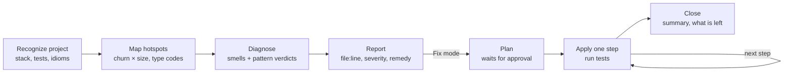

<div align="center">

# patternwise

**Design patterns and refactoring, applied like a senior engineer would: only where they pay off.**

An agent skill for Claude Code, Codex and any agent that reads `SKILL.md`. It finds code smells, judges the
design patterns already in your code, and refactors in small steps with tests, after you
approve the plan.

[](skills/patternwise/SKILL.md)
[](#install)
[](#install)
[](CHANGELOG.md)
[](LICENSE)
[](https://github.com/ciroperf/patternwise/actions/workflows/ci.yml)

```bash
npx skills@latest add ciroperf/patternwise
```

</div>

---

## The problem

Ask an AI agent to "refactor with design patterns" and you usually get one of two things:

- **Pattern cosplay**: an `AbstractNotifierFactory`, an `INotifier` with one implementation, an
  event bus between two functions. More files, same problems.
- **Vague advice**: "consider applying SOLID principles", with no line numbers and no plan.

patternwise makes the agent reason the way the refactoring literature does:

```
 code smell  ──▶  refactoring technique  ──▶  design pattern (only if it fixes a problem you have today)
 "switch on customer_type    "Replace Conditional       Strategy, as a dict of functions
  repeated in 3 places"       with Polymorphism"         (idiomatic Python, not a class zoo)
```

## What you get

**It judges existing patterns instead of just naming them.** Every occurrence gets exactly one
verdict:

| Verdict | Meaning |
|---|---|
| ✅ **Sound** | Intent, structure and trade-off fit the problem |
| ⚠️ **Misapplied** | Real structure, wrong problem: e.g. a Singleton used as global mutable state |
| 🏷️ **Name only** | Called `*Factory` / `*Manager` / `*Proxy` without the structure |
| 🧱 **Over-engineered** | Machinery with one variant: interface with one impl, factory for one product |
| ❓ **Uncertain** | Says so, and says what evidence would settle it |

**Every finding is evidence, not opinion**: `file:line`, severity weighted by git churn, the
concrete change it makes hard, and a named technique from a catalog of 66 refactorings.

**It deletes as readily as it adds.** Over-engineering is reported with the same seriousness as
smells. Remove Middle Man and Collapse Hierarchy are first-class remedies.

**It never edits without asking.** Fix mode shows a numbered plan, waits for approval, runs
your tests after every step, writes characterization tests first when there are none, and keeps
behavior identical.

### Example (real output, trimmed)

> **Patterns found**
>
> | Pattern | Where | Verdict | Evidence |
> |---|---|---|---|
> | Singleton | `shop/config.py:1` | ⚠️ Misapplied | `get_instance()` exposes mutable global state (`orders_count`); the constructor is still public |
> | "PaymentFactory" | `shop/payments.py:9` | 🏷️ Name only | `create()` always returns `CardPayment`: one product, no creation decision |
>
> **Code smells**
>
> | Smell | Where | Severity | Remedy |
> |---|---|---|---|
> | Long Method | `OrderProcessor.process` (`orders.py:19`) | High | Extract Method per phase: validation, totals, invoice |
> | Repeated switch on `customer_type` | `shop/orders.py:35, 54, 106` | Medium | Centralize the rules first; Strategy only if the variants keep growing |

## Three commands

patternwise never runs on its own: you call it, and you pick the mode.

| Claude Code | Codex | What it does | Edits code? |
|---|---|---|---|
| `/patternwise analyze src/` | `$patternwise analyze src/` | Pattern verdicts + code smells report | No |
| `/patternwise suggest src/` | `$patternwise suggest src/` | Analyze + where a pattern or refactoring pays off | No |
| `/patternwise fix shop/orders.py` | `$patternwise fix shop/orders.py` | Plan, your approval, then small steps with tests | Only after you approve the plan |

The path is optional, and anything after it is passed along as notes
(`/patternwise fix src/ keep the public API`). No mode means `analyze`. In Codex you can also
pick it from the `/skills` menu. Italian aliases work too: `analizza`, `suggerisci`, `sistema`.

Why explicit? A refactoring workflow should start when you ask for it, not because a prompt
happened to say "clean up". In our tests implicit triggering was the least reliable part:
another installed skill could win the match and edit without a plan.

## Install

### Any agent (Claude Code, Codex, Cursor, Copilot, Gemini CLI and more, via [skills.sh](https://skills.sh))

```bash
npx skills@latest add ciroperf/patternwise
```

Pick your agents interactively, or go non-interactive (`-g` = for your user, all projects):

```bash
npx skills@latest add ciroperf/patternwise -a claude-code -g
```

```bash
npx skills@latest add ciroperf/patternwise -a codex -g
```

### Claude Code plugin (auto-updates)

```
/plugin marketplace add ciroperf/patternwise
/plugin install patternwise@patternwise
```

### Codex plugin

```bash
codex plugin marketplace add ciroperf/patternwise
```

```bash
codex plugin add patternwise@patternwise
```

### Manual

Copy [`skills/patternwise/`](skills/patternwise) into `~/.claude/skills/` (Claude Code) or
`~/.agents/skills/` (Codex), or into a single repo's `.claude/skills/`.

Optional: Python 3 for the hotspot scanner. Without it the skill falls back to git and ripgrep.

## How it works



Under the hood:

- **[`SKILL.md`](skills/patternwise/SKILL.md)**: the workflow, severity rubric, report template
  and safety rules, about 200 lines.
- **[`references/`](skills/patternwise/references)**: loaded on demand, never all at once.
  - 23 code smells, each with treatments and when to ignore it.
  - Smell → technique → pattern chains.
  - 66 refactoring techniques with their mechanics.
  - All 22 GoF patterns with recognition cues, misuse signs and per-language idioms.
- **[`scripts/hotspots.py`](skills/patternwise/scripts/hotspots.py)**: a zero-dependency
  scanner that surfaces the largest and most-changed files, dense conditionals, and the same
  attribute compared against many literals across files, which is the main lead for
  Switch Statements. It takes about 10 s on Django's 124k lines.

## Tested, not vibed

The repo ships with [hand-built cases and answer keys](evals) and a citation checker that
flags any `file:line` or identifier the agent made up.

| Run | Claude Code | Codex |
|---|---|---|
| `py-orders` vs answer key | 2/2 pattern verdicts · **8/8 smells** · found and reproduced a real pricing bug | 2/2 pattern verdicts · 6/8 smells |
| Fix mode (`py-orders`, `js-notify`, `py-legacy-docs`) | Plan first, approval, tests green after every step, characterization tests first when there were none | Plan first, approval, tests green after every step, outputs unchanged |
| axios `lib/`, httpie, Django `db/backends` | 104 citations, 1 off-by-one line range, 0 invented files | 64 citations, **0 invented** |
| Real issues surfaced | httpie: shared mutable `env=Environment()` default in 5 places | httpie: plugin registry re-registers on every load |

Every finding quoted above was checked by hand against the code.

Every run on real repositories surfaced something that went back into the skill: Python- and
ripgrep-free fallbacks for sandboxed agents, test-noise filtering in the scanner, one verdict
per pattern, and reports that stay proportional to the code.

## Principles

**YAGNI / KISS** · **fit the codebase's existing style** · **evidence over labels** ·
**smallest effective treatment** · **behavior is sacred**

## Credits

The knowledge base is distilled and rewritten from Alexander Shvets' *Dive Into Design Patterns*
and *Dive Into Refactoring* and the [refactoring.guru](https://refactoring.guru) taxonomy. No
text from those works is reproduced. Buy the books, they are excellent.

## Contributing

Found a false positive, a missed smell, or a suggestion that does not pay off?
[Open a "wrong finding" issue](https://github.com/ciroperf/patternwise/issues/new?template=wrong-finding.yml)
with the report row and a minimal snippet. Each one becomes a regression case in `evals/`.
See [AGENTS.md](AGENTS.md) before changing the skill.

## Contributors

<a href="https://github.com/ciroperf/patternwise/graphs/contributors">
  
</a>

Created and maintained by [@ciroperf](https://github.com/ciroperf). Every merged PR and every
confirmed "wrong finding" report earns a spot here.

## License

[MIT](LICENSE) © ciroperf
